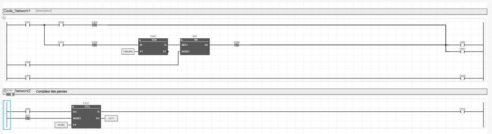
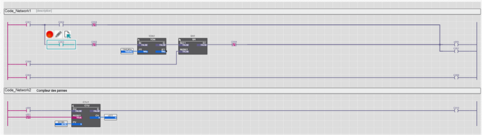
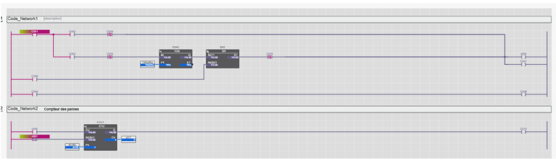
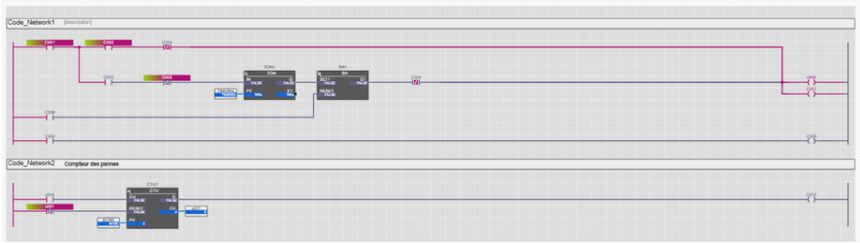
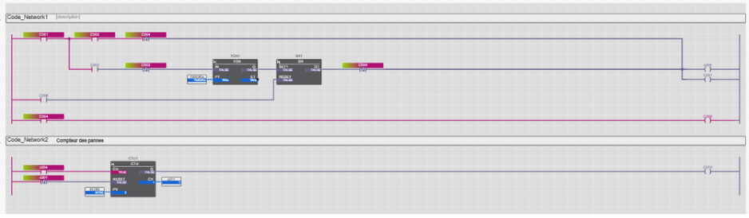
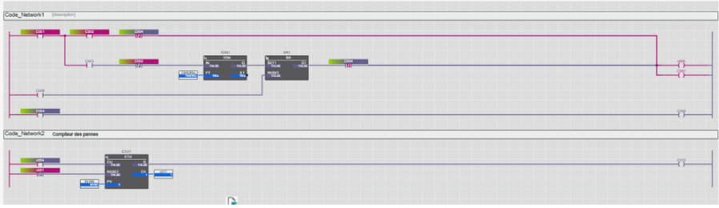
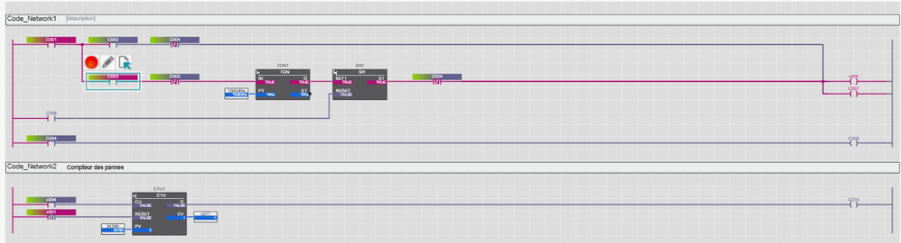
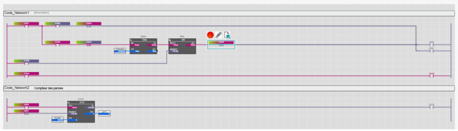
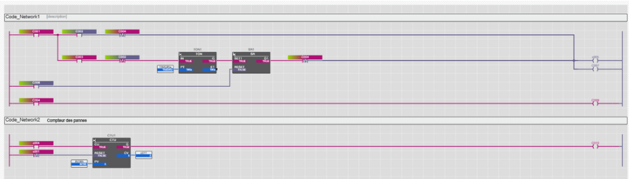

# Mini-projet – Automatisation d’un ventilateur industriel (PLCnext)

## Description

Ce mini-projet consiste à concevoir et simuler un **système d’automatisation industrielle** pour la commande d’un **ventilateur industriel**, en utilisant l’environnement **PLCnext Engineer** et le contrôleur **AXC F 1152**.
Le système intègre des **modes de fonctionnement manuel et automatique**, des **fonctions de sécurité**, ainsi qu’un **compteur de pannes** avec signalisation visuelle et sonore.

## Environnement technique

* **Logiciel** : PLCnext Engineer 2025 (LTS)
* **Contrôleur** : Phoenix Contact **AXC F 1152** (mode simulation)
* **Langage** : Ladder Diagram (LD – IEC 61131-3)
* **Mode d’exécution** : Simulation PLCnext (TCP/IP en mode simulation)

## Fonctionnalités principales

* Démarrage du système via bouton **ON**
* Deux modes de fonctionnement :

  * **Mode manuel** : commande directe du ventilateur
  * **Mode automatique** : commande temporisée avec bouton de reset
* **Gestion de la sécurité** par disjoncteur
* **Comptage des pannes (CTU)** :

  * Incrémentation à chaque panne
  * Mémorisation du nombre de pannes
  * Allumage d’une **LED rouge** lorsque le seuil (>5 pannes) est dépassé
* **Signalisation** :

  * LED verte : fonctionnement normal
  * LED rouge : défaut critique
  * Buzzer : alerte en cas de panne

## Structure du programme

* **Network 1** : Commande du ventilateur (modes manuel / automatique)
* **Network 2** : Gestion et comptage des pannes
* Utilisation de :

  * Logique combinatoire
  * Fonctions **Set/Reset**
  * Compteur incrémental **CTU**
  * Conditions de sécurité
  

## Validation

Le programme a été :

* Téléversé sur le contrôleur **AXC F 1152 en mode simulation**
* Testé et validé dans **PLCnext Engineer**
* Vérifié en conditions normales et en cas de panne

## Simulation

Ce système fonctionne en deux modes (mode manuel et mode automatique) et ne peut démarrer que lorsque le bouton ON (c001) est activé. Le compteur se réinitialise chaque fois la machine s’éteind, donc au début cv=0.

En mode manuel, le ventilateur démarre lorsque l’interrupteur de marche (c002) s’active ce qui allume la led verte (c007) et active le ventilateur (c005).

Dès qu’une panne occure, le disjoncteur (c004) s’active ce qui donne une impulsion au UTC pour incrémenter le compteur cv=1 et coupe le circuit désactivant ainsi le ventilateur et la led verte. Le buzzeur s’active par conséquence pour signaler un problème dans la machine.

Lorsque (c004) se désactive càd la machine est réparrée, le système continue son fonctionnement normal mais le compteur reste cv=1.

En mode automatique, le bouton marche manuel (c002) doit être désactivé pour éviter les erreurs. Lorsque le bouton poussoir marche automatique (c003) s’active pour 5s, le ventilateur (c005) démarre et la led verte (c007) s’allume jusqu’à ce que le bouton stop automatique le reset (c006) s’active.

Même pour le mode manuel, le mode automatique a le bouton de sécurité (c004).

Lorsque le nombre de pannes dépasse 5, la led rouge s’allume.

## Objectifs pédagogiques

* Comprendre l’architecture d’un programme PLC
* Maîtriser la programmation **Ladder**
* Mettre en œuvre des **fonctions de sécurité industrielles**
* Utiliser la **simulation PLC** pour valider un système automatisé sans matériel réel

---

[Accéder au repository complet](https://github.com/najmechorouk/automatisation-d-un-ventilateur-industriel/)
