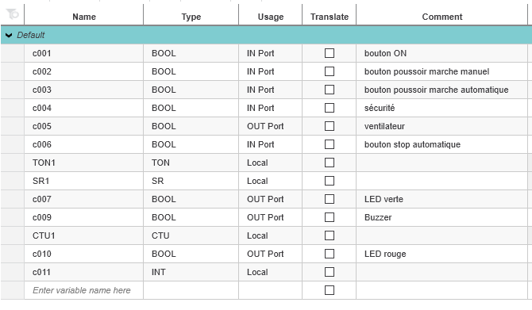

# Mini-projet – Automatisation d’un ventilateur industriel (PLCnext)

## Description

Ce mini-projet consiste à concevoir et simuler un **système d’automatisation industrielle** pour la commande d’un **ventilateur industriel**, en utilisant l’environnement **PLCnext Engineer** et le contrôleur **AXC F 1152**.
Le système intègre des **modes de fonctionnement manuel et automatique**, des **fonctions de sécurité**, ainsi qu’un **compteur de pannes** avec signalisation visuelle et sonore.

---

## Environnement technique

* **Logiciel** : PLCnext Engineer 2025 (LTS)
* **Contrôleur** : Phoenix Contact **AXC F 1152** (mode simulation)
* **Langage** : Ladder Diagram (LD – IEC 61131-3)
* **Mode d’exécution** : Simulation PLCnext (TCP/IP en mode simulation)

---

## Fonctionnalités principales

* Démarrage du système via bouton **ON**
* Deux modes de fonctionnement :

  * **Mode manuel** : commande directe du ventilateur
  * **Mode automatique** : commande temporisée avec bouton de reset
* **Gestion de la sécurité** par disjoncteur
* **Comptage des pannes (CTU)** :

  * Incrémentation à chaque panne
  * Mémorisation du nombre de pannes
  * Allumage d’une **LED rouge** lorsque le seuil (>5 pannes) est dépassé
* **Signalisation** :

  * LED verte : fonctionnement normal
  * LED rouge : défaut critique
  * Buzzer : alerte en cas de panne

---

## Structure du programme

* **Network 1** : Commande du ventilateur (modes manuel / automatique)
* **Network 2** : Gestion et comptage des pannes
* Utilisation de :

  * Logique combinatoire
  * Fonctions **Set/Reset**
  * Compteur incrémental **CTU**
  * Conditions de sécurité
  

---

## Validation

Le programme a été :

* Téléversé sur le contrôleur **AXC F 1152 en mode simulation**
* Testé et validé dans **PLCnext Engineer**
* Vérifié en conditions normales et en cas de panne

---

## Objectifs pédagogiques

* Comprendre l’architecture d’un programme PLC
* Maîtriser la programmation **Ladder**
* Mettre en œuvre des **fonctions de sécurité industrielles**
* Utiliser la **simulation PLC** pour valider un système automatisé sans matériel réel

---

[Accéder au repository complet](https://github.com/najmechorouk/automatisation-d-un-ventilateur-industriel/)
